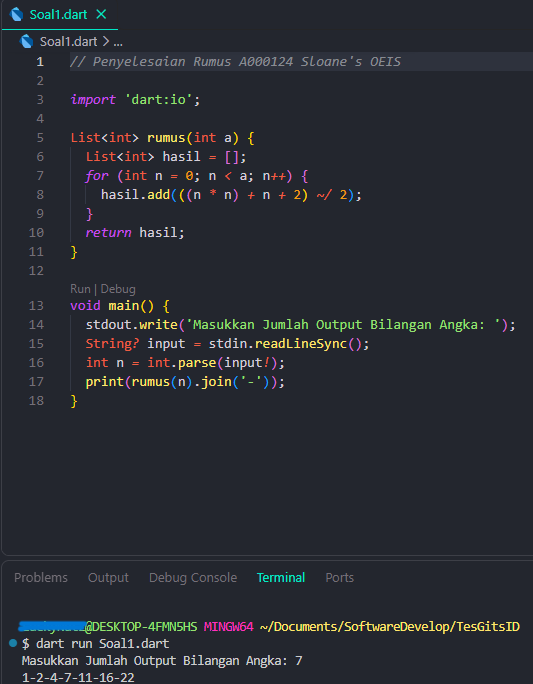
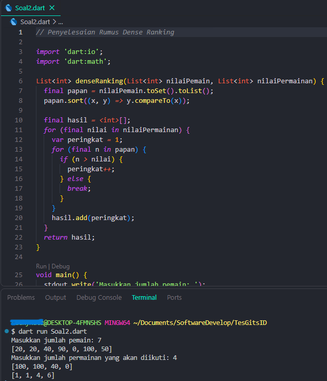
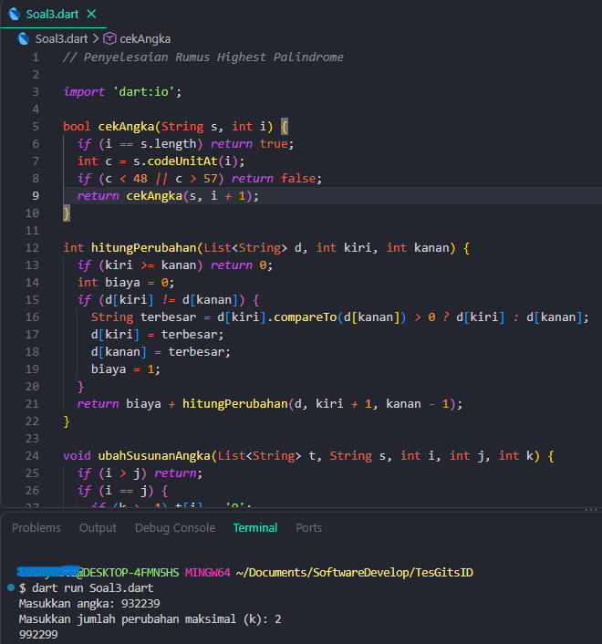

# Tes Technical GitsID

Kumpulan penyelesaian soal technical test menggunakan Dart.

## Persyaratan

- Dart SDK

## Cara Menjalankan

Jalankan perintah dari direktori repository:

```bash
dart Soal1.dart
dart Soal2.dart
dart Soal3.dart
```

## Soal 1 — A000124 (Sloane's OEIS)

Program menerima jumlah output dan menampilkan urutan bilangan A000124.

Screenshot:



## Soal 2 — Dense Ranking

Program menerima jumlah pemain dan jumlah permainan, menghasilkan nilai secara acak, lalu menghitung peringkat untuk setiap nilai permainan.

Screenshot:



> Nilai pemain dan permainan dibuat secara acak, sehingga hasil dapat berbeda setiap kali program dijalankan.

## Soal 3 — Highest Palindrome

Program menerima angka dan jumlah perubahan maksimum (`k`), lalu mencari palindrome terbesar yang dapat dibentuk. Jika tidak memungkinkan, program menampilkan `-1`.

Screenshot:


